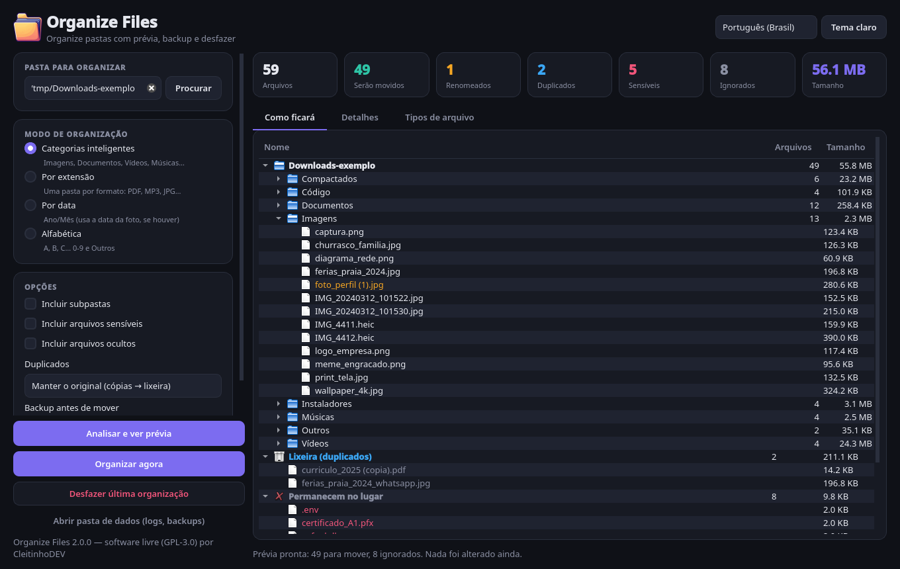
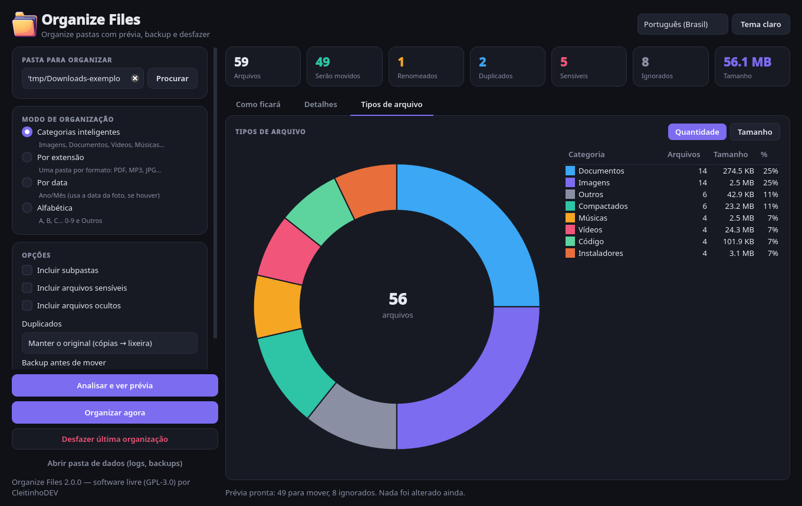
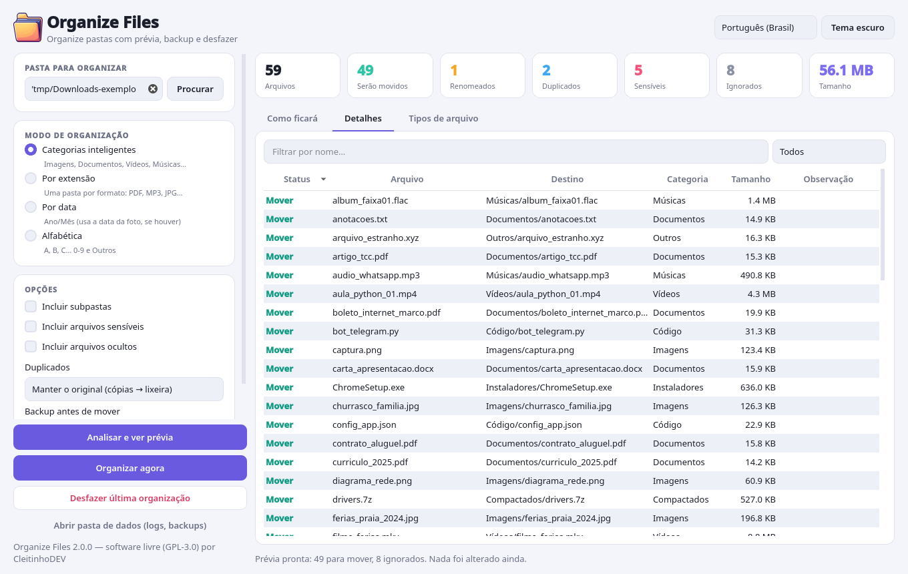
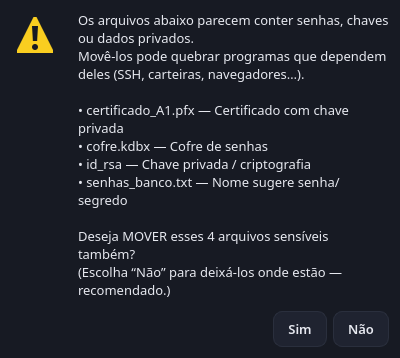
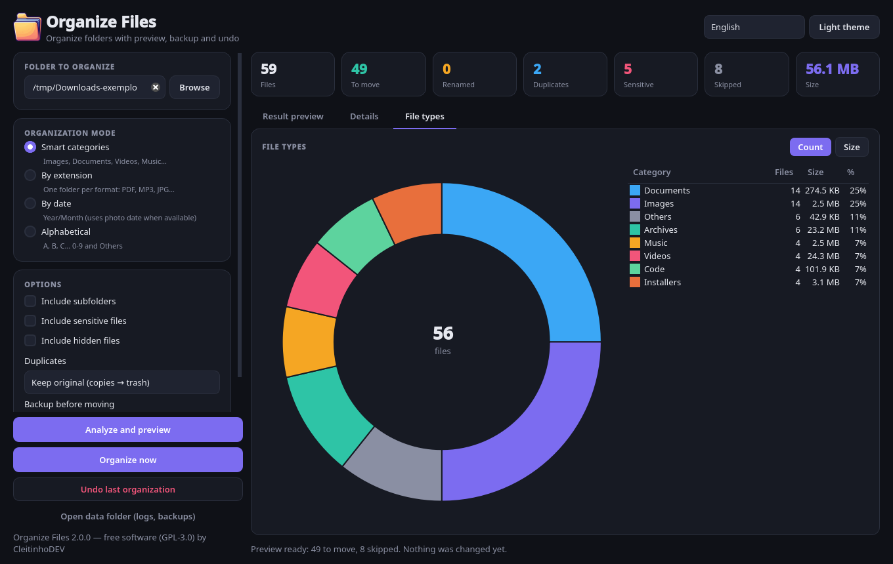

# 📁 Organize Files 2.0

Organize pastas bagunçadas (como **Downloads** ou **Área de Trabalho**) em poucos cliques, **vendo antes
como tudo vai ficar**. Com backup, desfazer, proteção de arquivos sensíveis e tratamento de duplicados.

> **English version below.** · Interface em **português (Brasil)** e **inglês**.



| Gráfico de tipos de arquivo | Detalhes de cada arquivo (tema claro) |
|---|---|
|  |  |

## ✨ Novidades da versão 2.0

A versão 2.0 foi reescrita do zero em **PySide6 (Qt 6)**. Os scripts antigos em CustomTkinter estão em [`legacy/`](legacy/).

- **Prévia "como ficará"**: uma árvore com as pastas que serão criadas e o que vai para cada uma. **Nada é movido antes de você confirmar.**
- **Gráfico de tipos de arquivo**: gráfico de rosca por categoria, por quantidade ou por tamanho, com legenda e porcentagens.
- **Tabela de detalhes** com busca e filtros (renomeados, duplicados, sensíveis, ignorados) e o motivo de cada decisão.
- **4 modos de organização**:
  - **Categorias inteligentes**: Imagens, Documentos, Vídeos, Músicas, Compactados, Código, Instaladores…
  - **Por extensão**: o antigo modo "Tipo"; uma pasta por formato (PDF, MP3…).
  - **Por data**: Ano/Mês. Para fotos, usa a data EXIF quando ela existe.
  - **Alfabética**: A–Z, 0-9 e Outros.
- **Duplicados**: detectados por conteúdo (SHA-256, não só pelo nome). Você escolhe entre manter o original e enviar as cópias para a **lixeira**, apenas pular, manter o mais novo, ou ignorar.
- **Subpastas (opcional)**: pastas de projetos (`.git`, `package.json`, `pyproject.toml`…) nunca são desmontadas.
- **Trabalho em segundo plano**: análise e organização rodam em uma *thread*, com barra de progresso e botão **Cancelar**, e a janela não trava.
- **Desfazer a última organização** com um clique.
- **Tema claro/escuro**, arrastar e soltar uma pasta na janela, e preferências salvas.
- **Linha de comando (CLI)** para usar em scripts.

## 🛡️ Segurança em camadas

O antigo programa podia **sobrescrever arquivos com o mesmo nome** e não tinha como voltar atrás. Agora:

1. **Nunca sobrescreve**: se o destino já existir, o arquivo vira `nome (1).ext`, `nome (2).ext`… (sem diferenciar maiúsculas de minúsculas, como no Windows/macOS).
2. **Pastas perigosas são bloqueadas**: raiz do disco, `C:\Windows`, `Program Files`, `AppData`, `/usr`, `/etc`, `/System`, `~/Library`, `~/.ssh`, `~/.config`… Organizar a **pasta pessoal inteira** exige digitar `ORGANIZAR` para confirmar.
3. **Arquivos sensíveis ficam no lugar**: chaves (`id_rsa`, `.pem`, `.pfx`), `.env`, cofres de senha (`.kdbx`), carteiras, bancos de dados e nomes como "senha" ou "password" **não são movidos por padrão**. Se você decidir incluí-los, aparece um **aviso listando cada um**.
   
4. **Arquivos sensíveis nunca vão para a lixeira** como "duplicados", a menos que você permita explicitamente (CLI: `--permitir-lixeira-sensiveis`).
5. **Arquivos de sistema, ocultos e temporários são ignorados**: `desktop.ini`, `.DS_Store`, `Thumbs.db`, downloads incompletos (`.crdownload`, `.part`) e atalhos. O próprio executável do programa também nunca é movido.
6. **Backup opcional antes de mover**: um **ZIP** ou uma **cópia da pasta**, guardado na pasta de dados do app.
7. **Diário de desfazer**: cada movimentação é registrada em JSON, salvo de forma atômica durante a execução. Se o programa fechar no meio, o desfazer ainda funciona.
8. **Exclusões vão para a lixeira do sistema** (via Send2Trash), nunca são apagadas direto.
9. **Log detalhado** de tudo o que foi feito, com rotação automática.

## 🚀 Como usar

### Executável pronto
Baixe o arquivo do seu sistema na aba **Actions** (artefatos do último build) ou em **Releases**:
`OrganizeFiles-windows-*.exe`, `OrganizeFiles-macos-*.zip` (app) ou `OrganizeFiles-linux-*`.

> No macOS o app não é assinado. Na primeira vez, abra com **botão direito → Abrir**.

### A partir do código-fonte (Python 3.10+)
```bash
git clone https://github.com/cleitinhodev/OrganizeFiles.git
cd OrganizeFiles
git checkout revitalize-pyside6
python -m venv .venv
# Windows: .venv\Scripts\activate   |   Linux/macOS: source .venv/bin/activate
pip install -e ".[exif]"        # ou: pip install -r requirements.txt
python -m organizefiles          # abre a interface
```

### Linha de comando
```bash
# só ver a prévia (não mexe em nada)
python -m organizefiles ~/Downloads --dry-run

# organizar por categoria, com backup ZIP e duplicados para a lixeira
python -m organizefiles ~/Downloads --backup zip --duplicados trash

# por data (ano/mês), incluindo subpastas, sem perguntar
python -m organizefiles ~/Fotos --modo data --recursivo --sim

# desfazer a última organização
python -m organizefiles --desfazer
```
Modos: `categoria` (padrão), `extensao` (ou `tipo`), `data`, `abc`. Veja todas as opções com `--help`.
Depois de `pip install`, os comandos `organizefiles` (interface) e `organizefiles-cli` também ficam disponíveis.

## ⚙️ Personalizar categorias
Copie [`organizefiles/resources/default_rules.json`](organizefiles/resources/default_rules.json) para
`rules.json` dentro da **pasta de dados** e edite os nomes, as cores e as extensões. Na CLI, também dá para usar `--regras arquivo.json`.

**Pasta de dados** (diários de desfazer, backups, logs e `rules.json`). O botão "Abrir pasta de dados" na interface abre essa pasta:

| Sistema | Local |
|---|---|
| Windows | `%APPDATA%\OrganizeFiles` |
| macOS | `~/Library/Application Support/OrganizeFiles` |
| Linux | `~/.local/share/organizefiles` (ou `$XDG_DATA_HOME`) |

Para trocar o local, defina a variável `ORGANIZEFILES_DATA_DIR`.

## 🧑‍💻 Desenvolvimento
```bash
pip install -e ".[dev]"
pytest -q                       # no Linux sem tela: QT_QPA_PLATFORM=offscreen pytest -q
python scripts/build_exe.py     # gera o executável em dist/ (PyInstaller)
```

Estrutura do projeto:
```
organizefiles/
├── core/         # lógica sem interface (testável)
│   ├── planner.py     # monta o plano / prévia
│   ├── executor.py    # executa o plano e desfaz
│   ├── safety.py      # pastas bloqueadas, sensíveis, ocultos
│   ├── duplicates.py  # SHA-256 em etapas (tamanho → início → completo)
│   ├── journal.py     # diário de desfazer
│   ├── backup.py      # ZIP / cópia
│   └── rules.py, naming.py, dates.py, hashing.py, models.py
├── gui/          # PySide6: janela, prévia, gráfico, tema, workers (QThread)
├── cli.py        # linha de comando
├── i18n.py       # textos pt-BR / en
└── resources/    # regras padrão e ícone
tests/            # pytest + pytest-qt
legacy/           # versão 1.x (CustomTkinter), só para referência
```

O **GitHub Actions** roda os testes no Windows, no macOS e no Linux e gera os executáveis com PyInstaller.
Uma tag `v*` publica tudo como Release.

## 📄 Licença
[GPL-3.0](LICENSE) © CleitinhoDEV

---

# 🇺🇸 English

**Organize Files** tidies up messy folders (Downloads, Desktop…) and **shows you the result before anything is moved**.
Version 2.0 is a full rewrite in **PySide6 (Qt 6)**, with an English and Brazilian Portuguese UI.



**Features**
- A **"Result preview" tree**, a details table with filters, and a **file-type donut chart** (by count or size).
- **Modes**: smart categories, by extension, by date (Year/Month, using EXIF for photos), and alphabetical.
- **Duplicate detection** by content (SHA-256). Copies can go to the **system trash**, be skipped, or keep only the newest file.
- Optional recursion, which never breaks apart project folders (`.git`, `package.json`…).
- A background worker (QThread) with progress and **Cancel**. **One-click undo**. Light and dark themes. Drag and drop.
- A **CLI**: `python -m organizefiles <folder> [--dry-run] [--modo categoria|extensao|data|abc] [--backup zip|folder] [--duplicados trash|skip|newest] [--desfazer]`.

**Safety**
- Files are never overwritten (`name (1).ext`).
- System and root folders are blocked. Organizing your whole home folder requires typed confirmation.
- Sensitive files (keys, `.env`, password vaults, wallets…) are left in place by default. Including them shows a warning with the full list, and they are never trashed as duplicates unless you explicitly allow it.
- System, hidden, temporary, and partial-download files are skipped.
- Optional ZIP or folder backup. An atomic undo journal. Deletions only go to the trash. Rotating logs.

**Run from source**
```bash
pip install -e ".[exif]"
python -m organizefiles          # GUI
python -m organizefiles --help   # CLI
```
Custom categories: copy `organizefiles/resources/default_rules.json` to `rules.json` in the app data folder
(`%APPDATA%\OrganizeFiles`, `~/Library/Application Support/OrganizeFiles`, or `~/.local/share/organizefiles`).

**Development**: `pip install -e ".[dev]" && pytest -q`. To build: `python scripts/build_exe.py`.
CI runs the tests and builds Windows, macOS, and Linux executables.

License: GPL-3.0.
